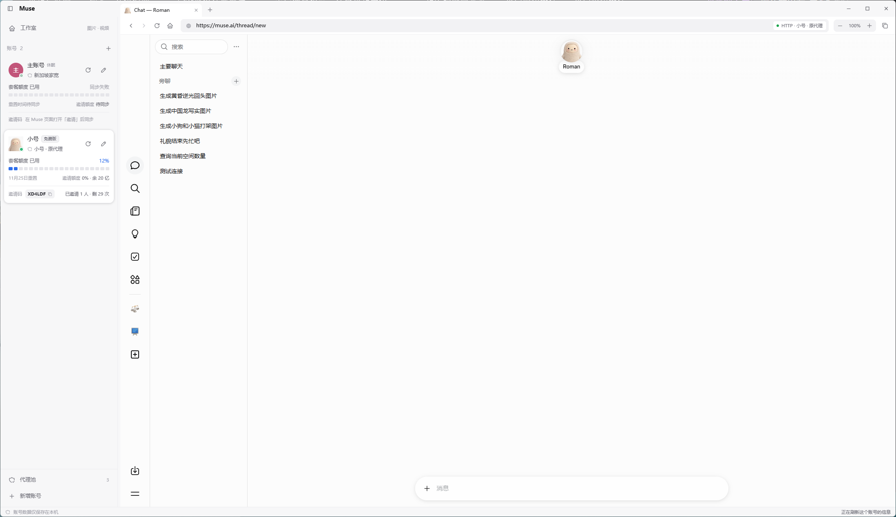

# Muse Desktop

面向 Muse.ai 的非官方多账号客户端，使用 Rust 和 GPUI 构建。Windows 使用 WebView2，macOS 使用 WKWebView。

## 界面预览



## 功能

- 多账号独立浏览器环境、账号切换、标签页和登录状态保存。
- 账号套餐、周额度、邀请额度与头像同步。
- HTTP / HTTPS / SOCKS5 代理池，每账号独立路由，凭据由 Windows 加密保存。
- 原生图片 / 视频创作工作室、参考图片、生成进度和本地媒体查看。
- 可调整的侧栏、窗口位置记忆及快捷键。
- 页面缩放记忆与白天 / 晚上主题切换，重启后恢复上次设置。

## 下载与运行

在本仓库的 **Releases** 页面下载 `Muse-Desktop-<版本>-win-x64.zip`，解压后运行 `Muse.exe`。
需要 Windows 10/11 x64 和 Microsoft Edge WebView2 Evergreen Runtime，不需要安装 .NET。

macOS 版要求 macOS 14 或更新版本：Apple 芯片选择 `macos-arm64.app.zip`，Intel 选择 `macos-x64.app.zip`。解压后将 `Muse.app` 放入「应用程序」。当前 Mac 包为临时签名的开发构建，尚未进行 Apple 开发者签名与公证。

默认数据目录为 `%LOCALAPPDATA%\MuseDesktopNext`。已有用户可用
`Muse.exe --data-dir "原数据目录"` 沿用账号和历史；升级时不要删除该目录。
安装包不包含开发者的账号、Cookie、代理凭据或聊天数据。

macOS 的配置目录是 `~/Library/Application Support/MuseDesktopNext`；每个账号使用独立的 WebKit 持久化存储，代理凭据保存到登录钥匙串。Windows 的浏览器登录目录与 DPAPI 凭据不能直接复制为 Mac 登录环境，需要在 Mac 上重新登录和配置代理。Mac 暂不提供 WebView2 的后台页面休眠能力。

## 从源码构建

安装 Rust / rustup、Visual Studio 2022 C++ 构建工具（含 Windows SDK）和 Node.js 22 及以上。
仓库的 `rust-toolchain.toml` 固定 Rust 1.95.0，Cargo.lock 固定依赖版本。

```powershell
cargo test --workspace --locked
cargo build --release --locked -p muse-desktop
.\scripts\package-windows.ps1
```

构建结果在 `target/release/muse-desktop.exe`，便携 ZIP 和 SHA-256 校验文件在 `dist/`。
开发运行：`.\scripts\run.ps1`；浏览器账号数据、测试数据与缓存均被 Git 忽略。

macOS 源码构建需要 Xcode 命令行工具、Rust 1.95.0、Node.js 22+ 和 Python 3：

```bash
export MACOSX_DEPLOYMENT_TARGET=14.0
cargo test --workspace --locked
cargo build --release --locked -p muse-desktop
python3 scripts/check-macos-smoke.py
python3 scripts/package-macos.py --arch arm64  # Intel Mac 改为 x64
```

```powershell
cargo fmt --all -- --check
node --test scripts/check-observer.cjs
node scripts/check-studio.cjs
node scripts/check-original-media.cjs
node scripts/check-reference-upload.cjs
.\scripts\check-package.ps1
```

## 自动构建与发布

- 提交到 `main`、提交 Pull Request 或在 Actions 中手动运行 **Desktop clients**，会执行检查、测试、编译并上传 Windows ZIP 与两个架构的 Mac 应用包。
- 普通构建产物位于该次 Actions 运行的 Artifacts，保留 14 天。
- 发布新版本时先修改根 `Cargo.toml` 的 `[workspace.package].version`，提交后推送同版本的 `v*` 标签。
- Windows、macOS ARM64 与 macOS Intel 标签构建全部通过后，自动创建 GitHub Release，附带三个客户端包和 SHA-256 校验文件；标签与源码版本不符会拒绝发布。

```powershell
git tag v0.1.1
git push origin v0.1.1
```

手机端是独立的 `muse-android` 仓库。两个客户端各自保存账号和历史，不自动同步。

## 社区致谢

感谢 [LINUX DO](https://linux.do/) 社区的交流与分享。本项目认可并支持 LINUX DO 社区的开源交流与互助。

## 许可证

原创代码采用 MIT。适配自 GPUI 的输入组件保留 Apache-2.0 许可，Tabler 图标和
MUSE2API 相关适配保留相应 MIT 说明；详见 `NOTICE`、`THIRD_PARTY_NOTICES.md` 和 `LICENSES/`。
